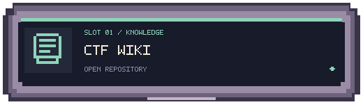
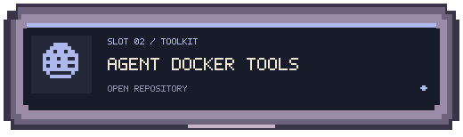
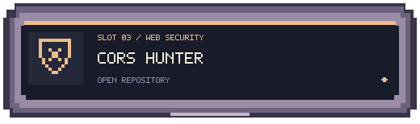
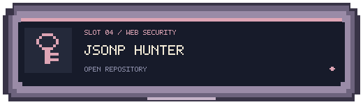
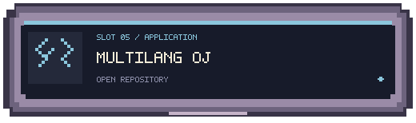
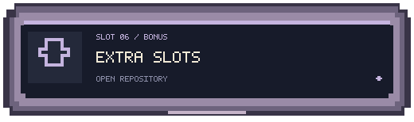

  

<h2 align="center">SELECT CARTRIDGE</h2>

Choose a cartridge to open its repository.

<table>
<tr>
<td width="50%" valign="top">

A CTF knowledge base for LLM agents, with structured pages, retrieval keywords, cross-references, and Obsidian support.

<code>LLM Agents</code> <code>CTF</code> <code>Obsidian</code>

</td>
<td width="50%" valign="top">

A reusable Docker environment for CTF analysis tools and GhidraMCP, connecting agents, knowledge retrieval, and tool execution.

<code>Docker</code> <code>Python</code> <code>MCP</code>

</td>
</tr>
<tr>
<td width="50%" valign="top">

A Burp Suite extension for probing CORS rules, validating preflight behavior, and exporting browser verification pages.

<code>Burp Suite</code> <code>Java</code> <code>CORS</code>

</td>
<td width="50%" valign="top">

A Burp Suite extension based on <a href="https://github.com/kapytein/jsonp">kapytein/jsonp</a>, using randomized callbacks to help assess cross-origin data exposure.

<code>Burp Suite</code> <code>Jython</code> <code>JSONP</code>

</td>
</tr>
<tr>
<td width="50%" valign="top">

An online judge with an integrated code editor, problem data, and backend services for compiling and running Java and C.

<code>Spring Boot</code> <code>Vue 3</code> <code>MySQL</code>

</td>
<td width="50%" valign="top">

Two smaller projects: a Chinese localization toolkit and a campus marketplace frontend demo.

<code>Python</code> <code>HTML</code> <code>JavaScript</code>

</td>
</tr>
</table>

### BONUS SLOTS

- **[Rally Navigator Chinese Localization](https://github.com/doudou0308/Rally-Navigator-translate-CN)** — Python-generated translations with deployment and restoration scripts.
- **[Campus Second-Hand Marketplace](https://github.com/doudou0308/campus-second-hand)** — Category browsing and form validation in a static frontend demo.

◆ &nbsp; END OF MENU &nbsp; ◆

