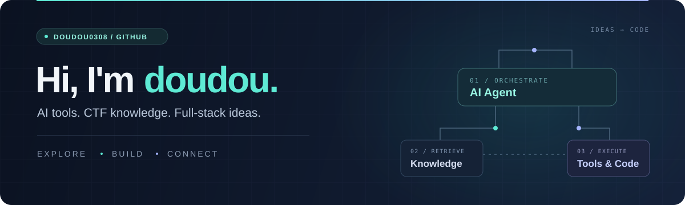
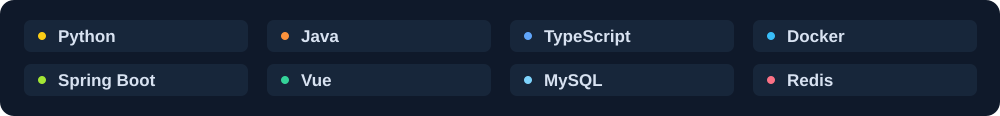

  

  <a href="https://github.com/doudou0308?tab=repositories">项目 / Projects</a>
  &nbsp; · &nbsp;
  <a href="https://github.com/doudou0308/ctf-wiki">CTF Wiki</a>
  &nbsp; · &nbsp;
  <a href="https://github.com/doudou0308/agent-docker-tools">Agent Tools</a>

<h3 align="center">把想法写成代码，把经验整理成知识。</h3>

Exploring AI agents, CTF, and useful software.

---

### 👋 关于我 / About

我是 **doudou**。这里记录我的开发实践：从面向 AI Agent 的 CTF 知识库和 Docker 工具环境，到在线判题系统、校园网站与软件汉化。

- **AI × CTF** — 探索知识检索、Agent 编排与工具执行之间的协作。
- **Web 开发** — 用 Java、Spring Boot 和 Vue 把功能做成可以使用的应用。
- **实用工具** — 用 Python 脚本与中文本地化，让软件更方便使用。

### 🧰 项目中使用的技术 / Toolbox

  

### ✨ 项目精选 / Selected projects

#### 🧠 [CTF Wiki](https://github.com/doudou0308/ctf-wiki)

**面向 LLM Agent 的 CTF 知识图谱。** 通过结构化知识页面、检索触发词和交叉引用，连接解题思路与参考资料；支持在 Obsidian 中浏览。

`LLM Agents` · `Knowledge Graph` · `CTF` · `Obsidian`

#### 🐳 [Agent Docker Tools](https://github.com/doudou0308/agent-docker-tools)

**把 CTF 工具装进可复用的 Docker 环境。** 集成安全分析工具与 GhidraMCP，配合 Agent 和 CTF Wiki，串联规划、知识检索与工具执行。

`Docker` · `Python` · `MCP` · `CTF Tooling`

#### ⚡ [MultiLang OJ](https://github.com/doudou0308/MultiLang-OJ-LLM)

**基于 Spring Boot + Vue 3 的多语言在线判题系统。** 支持 Java / C 编译运行，将后端服务、题目数据与在线代码编辑连接起来。

`Java` · `Spring Boot` · `Vue 3` · `TypeScript` · `MySQL`

<b>更多实践 / More projects</b>

 

- 🏁 **[Rally Navigator 中文汉化](https://github.com/doudou0308/Rally-Navigator-translate-CN)** — 用 Python 生成简体中文翻译，提供部署与还原脚本。
- ♻️ **[校园二手交易平台](https://github.com/doudou0308/campus-second-hand)** — 使用 HTML、CSS 和原生 JavaScript 实现分类浏览、闲置发布与表单验证。

---

  感谢来访 · Thanks for stopping by 
  欢迎浏览项目，也欢迎在对应仓库交流想法。

